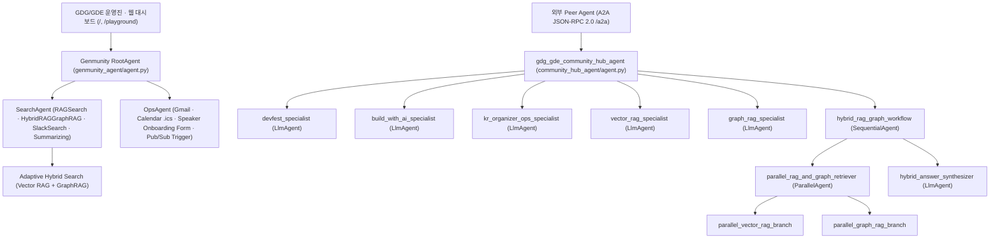

# AGENTS.md — Genmunity & GDG/GDE Community Hub ADK Multi-Agent Architecture

본 문서는 **GDG / GDE / GDGoC 이벤트 운영진**을 위한 **Google ADK (Agent Development Kit)** 기반 멀티 에이전트 시스템, **GCP 하이브리드 RAG (Vector RAG + GraphRAG)** 파이프라인, **A2A (Agent2Agent) 오픈 프로토콜 서버**, 그리고 **Google Workspace (Gmail, Calendar, Forms, Slides, Sheets)** 이벤트 운영 자동화 워크플로우의 전체 설계 및 구현 명세를 정리한 문서입니다.

---

## 1. 전체 에이전트 아키텍처 (Google ADK Hierarchy)

시스템은 크게 **1) 이벤트 운영 및 커뮤니티 통합 플랫폼(`genmunity_agent`)**과 **2) 커뮤니티 허브 지식 검색 및 A2A 전용 에이전트(`community_hub_agent`)**가 유기적으로 결합된 구조로 동작합니다.



### 1.1 `genmunity_agent` (이벤트 운영 & 스피커 매칭 멀티 에이전트)
- **`RootAgent` (`genmunity_agent/agent.py`)**:
  - 사용자 의도를 파악하여 `SearchAgent`(데이터 탐색/연사 추천/예산·일정 확인)와 `OpsAgent`(연사 섭외 메일 발송/수신 클러스터링/사전 정보 Form 생성/캘린더 초대)를 조율합니다.
- **`SearchAgent` (`genmunity_agent/sub_agents/search_agent.py`)**:
  - `rag_search_tool`: DevFest 핸즈온 스피커 추천(**1순위 한성민 AI GDE `sniper45han@gmail.com`**, **2순위 박제창 Flutter GDE `aristojeff@gmail.com`**), 시즌 일정/마감일, 예산 규모 및 Adaptive Vector RAG + GraphRAG 결과를 통합 반환합니다.
  - `hybrid_community_hub_rag_tool`: 171개 임베딩 청크와 435개 지식 그래프 노드를 가로질러 질문 유형에 맞춰 `vector_rag` / `graph_rag` / `hybrid` 전략을 자동 선택해 답변합니다.
  - `slack_search_tool`: GDG Korea `#organizers`(`C04E1UAAY`) 실제 슬랙 스레드(28개 스레드 + 답글) 및 운영진 채널을 검색합니다.
  - `summarize_community_data_tool`: 검색된 연사 및 행사 정보를 요약하여 `OpsAgent`로 핸드오프합니다.
- **`OpsAgent` (`genmunity_agent/sub_agents/ops_agent.py`)**:
  - **Step 1 (`get_target_speakers_tool`)**: 매칭된 핸즈온 연사자 2명 프로필 확인
  - **Step 2 (`generate_and_send_speaker_emails_tool`)**: Gemini 기반 맞춤형 초청장 생성 및 Gmail API 실발송
  - **Step 3 (`collect_and_cluster_event_emails_tool`)**: Gmail 수신함(`devstar5011@gcplab.me`)에서 행사 관련 메일 수집 및 AI 의미론적 클러스터링
  - **Step 4 (`create_speaker_onboarding_form_tool`)**: 발표자 성함, 이메일, 연락처, 티셔츠 사이즈, 차량 번호 수집용 온보딩 Form 생성
  - **Step 5 (`invite_speakers_with_form_and_calendar_tool`)**: 온보딩 Form 링크 + Google Calendar 일정 초대장(`.ics`) 발송

### 1.2 `community_hub_agent` (ADK Adaptive Vector RAG + GraphRAG + A2A 에이전트)
- **`gdg_gde_community_hub_agent` (`community_hub_agent/agent.py`)**:
  - **도메인 전문 Sub-Agents**:
    - `devfest_specialist`: DevFest 커뮤니티 허브 가이드라인 및 페이지 내부 Google Slides 발표장표 전담
    - `build_with_ai_specialist`: Build with AI 허브(`?hl=ko`) 및 공식 Google Slides(`1CiGLGl91Nh_6kZOxeoHcH9hblmdx2Rt0oF5qX6jjEwE`, `1d6c0wAYCs3zfROf9l6QbSjhLxZbrGByx4CnqaF6rPcY`) 전담
    - `kr_organizer_ops_specialist`: 국내 운영진/GDE/GDGoC 엑셀 시트 2종 및 GDG Korea `#organizers` 슬랙 히스토리 전담
  - **ADK Workflow Agents (`ParallelAgent` + `SequentialAgent`)**:
    - `vector_rag_specialist`: 단일 문서/슬라이드 수치·일정·예산·크레딧 규정 검색 시 **Vector RAG** 단독 실행
    - `graph_rag_specialist`: 챕터 간 공동 주최(Co-hosting), 오거나이저↔연사(GDE) 겸임, 다중 홉 관계망 질문 시 **GraphRAG** 단독 실행
    - `hybrid_rag_graph_workflow` (`SequentialAgent`):
      1. `parallel_rag_and_graph_retriever` (`ParallelAgent`): `parallel_vector_rag_branch`와 `parallel_graph_rag_branch`를 **병렬 실행**하여 세션 상태(`session.state["vector_rag_context"]`, `session.state["graph_rag_context"]`)에 저장
      2. `hybrid_answer_synthesizer` (`LlmAgent`): 두 컨텍스트를 결합하여 출처(Citation)와 그래프 경로가 모두 포함된 최종 답변 합성

---

## 2. GCP 기반 RAG + GraphRAG 3단계 아키텍처

| 구분 | 접근법 1: 완전 관리형 (Vertex AI Search) | 접근법 2: 모듈형 커스텀 Vector RAG | 접근법 3: ADK GraphRAG & Hybrid Workflow |
| :--- | :--- | :--- | :--- |
| **핵심 서비스 / 모듈** | Vertex AI Agent Builder Data Store (`vertex_search.py`) | `VertexAIEmbeddingService` (`text-embedding-005`, `768`차원) + Vector DB (`custom_pipeline.py`) | `CommunityKnowledgeGraph` (`graph_rag.py`) + ADK `ParallelAgent` → `SequentialAgent` |
| **인덱스 / 데이터 규모** | GCS 문서 자동 파싱 & Grounding | **171개 청크** (`data/indexed_chunks.json`, **임베딩 완료율 100%**) | **435개 엔티티 노드 / 843개 관계 엣지** (`data/knowledge_graph.json`) |
| **최적 활용 상황** | 대규모 문서 턴키 검색 | 슬라이드 페이지별 수치, 타임라인, 예산/크레딧 규정, 연락처 조회 | 챕터 연합/공동 주최 관계망, GDE↔오거나이저 겸임, 다중 홉(Multi-hop) 추론 |

### 2.1 자동 쿼리 라우터 (`classify_query_strategy` in `community_hub_agent/rag/retriever.py`)
질문의 의도를 분석해 최적의 검색 파이프라인을 자동 선택합니다:
- **`vector_rag`**: 예산, 크레딧 신청 기한, 체크리스트(D-60~D+7), 로고/브랜딩 가이드 등 팩트/가이드라인 질문
- **`graph_rag`**: 공동 주최(Co-hosting) 챕터 네트워크, 겸임 활동가, 연결 관계망, 다중 홉 탐색 질문
- **`hybrid`**: 관계망 탐색과 문서/슬라이드/슬랙 세부 수치·링크가 동시에 필요한 복합 질문

---

## 3. 크롤링 및 임베딩 완료 데이터 소스 명세 (100% 검증 완료)

`scripts/ingest.py --source all` 실행 및 `/api/rag/audit` 실시간 감사 엔드포인트를 통해 검증된 전체 데이터셋 현황입니다.

| # | 데이터 소스 | 원본 경로 / URL | 수집·파싱 현황 | 인덱싱 청크 수 | 임베딩율 (`768`차원) |
| :-: | :--- | :--- | :--- | :-: | :-: |
| 1 | **DevFest 커뮤니티 허브 & 내부 슬라이드** | `https://developers.google.com/community/community-hub/event-series/devfest` | 허브 가이드 + DevFest 오거나이저 툴킷 슬라이드 파싱 완료 | 3 chunks | **100%** (3/3) |
| 2 | **Build with AI 허브 (`?hl=ko`)** | `https://developers.google.com/community/community-hub/event-series/build-with-ai?hl=ko` | 한국어 허브 가이드 파싱 완료 | 1 chunk | **100%** (1/1) |
| 3 | **Build with AI 공식 Google Slides** | `1CiGLGl91Nh_6kZOxeoHcH9hblmdx2Rt0oF5qX6jjEwE` (`resourcekey=0-x_2s2Y1o88-1mNOmoQipTA`) | 21장 슬라이드 핵심 요약 및 크레딧/시간표 파싱 완료 | 3 chunks | **100%** (3/3) |
| 4 | **2025 I/O Extended Organizer Guide 슬라이드** | `1d6c0wAYCs3zfROf9l6QbSjhLxZbrGByx4CnqaF6rPcY` | Google Slides export API로 **23개 슬라이드 실시간 파싱** 완료 | 23 chunks | **100%** (23/23) |
| 5 | **2026 GDG Korea Offsite 슬라이드** | `1fnQNauWcxgt5eqhTAuaBGn2giNQU6f_f_fv3R7nAvp4` | 슬랙 공유 오프사이트 덱 **8개 슬라이드 실시간 파싱** 완료 | 8 chunks | **100%** (8/8) |
| 6 | **국내 운영진 이벤트 & Active Rate 시트** | `data/raw/gdg_kr_communication.xlsx` (`[External] GDG KR Communication.xlsx`) | **11개 시트 탭 전체 / 163개 행** (`26~24 이벤트`, `26 Active Rate` 등) | 39 chunks (38+1) | **100%** (39/39) |
| 7 | **국내 GDG 리드 · GDE · GDGoC 디렉토리** | `data/raw/gdg_gde_gdgoc_list_korea.xlsx` (`[External] GDG, GDE, GDGoC List - Korea.xlsx`) | **4개 시트 탭 전체 / 311개 행** (GDG 리드 130행, GDE 47명, GDGoC 65개 대학) | 65 chunks | **100%** (65/65) |
| 8 | **GDG Korea `#organizers` 슬랙 채널** | `data/raw/slack_gdgkr_organizers_C04E1UAAY.json` (`C04E1UAAY`) | 최근 1년 주요 **28개 스레드 + 전체 댓글(`replies_full`)** 파싱 완료 | 29 chunks | **100%** (29/29) |
| **합계** | **전체 8개 소스** | `data/indexed_chunks.json` & `data/knowledge_graph.json` | **지식 그래프 435 Nodes / 843 Edges** | **171 Chunks** | **100% (171/171)** |

### 지식 그래프 (`data/knowledge_graph.json`) 엔티티 구성
- **Nodes (435개)**: `Person` (208), `Event` (85), `Chapter` (59), `Venue` (47), `Topic` (11), `CampaignPolicy` (10), `Region` (7), `CampaignSeries` (5), `SlideDeck` (2), `SlackChannel` (1)
- **Edges (843개)**: `ORGANIZED_EVENT` (219), `LOCATED_IN` (186), `HAS_TOPIC` (146), `HELD_AT` (79), `LEADS_CHAPTER` (71), `BELONGS_TO_SERIES` (55), `EXPERT_IN` (35), `DISCUSSED_IN` (29), `CO_HOSTED_WITH` (12), `SPOKE_AT` (8), `GOVERNS` (3)

---

## 4. A2A (Agent2Agent) 프로토콜 명세

외부 에이전트가 표준 A2A 프로토콜을 통해 `gdg_gde_community_hub_agent`를 탐색하고 RAG/GraphRAG 데이터를 교환할 수 있습니다.

1. **Agent Card Discovery (`GET`)**:
   - `/.well-known/agent.json`
   - `/.well-known/agent-card.json`
   - 에이전트 메타데이터, 입출력 모드, 4대 핵심 스킬(`devfest_community_hub_rag`, `build_with_ai_rag`, `kr_organizer_sheet_lookup`, `community_knowledge_graph_rag`) 반환
2. **A2A JSON-RPC 2.0 엔드포인트 (`POST /a2a`)**:
   - 지원 메서드: `message/send`, `tasks/send`, `agent/authenticatedExtendedCard`, `agent/card`
   - 응답 구조:
     - `parts[0]` (`kind: "text"`): 에이전트 한국어 마크다운 답변
     - `parts[1]` (`kind: "data"`): 구조화된 메타데이터 (`source_agent`, `execution_mode`, `routing`, `citations`, `graph_triples`)
3. **Direct A2A REST 데이터 교환 엔드포인트 (`POST`)**:
   - `/a2a/rag`: Adaptive Vector RAG + GraphRAG 통합 페이로드 반환
   - `/a2a/graph-rag`: 다중 홉(`max_hops`) 서브그래프 트리플 및 엔티티 매칭 전용 반환

---

## 5. 인터랙티브 웹 UI 및 운영진 샘플 질문 (8종)

서버 실행 시 두 개의 대시보드 화면을 제공합니다:
1. **`GET /` (Genmunity Builderthon Event Ops Dashboard)**:
   - `RootAgent` ↔ `SearchAgent` ↔ `OpsAgent` 5단계 연사 섭외·메일 클러스터링·온보딩 Form·캘린더 초대 자동화 콘솔
2. **`GET /playground` (GDG/GDE Community Hub RAG · GraphRAG · A2A 테스트 & 데이터 감사 콘솔)**:
   - **실시간 데이터 크롤링 & 임베딩 감사 테이블** (`/api/rag/audit`): 8개 데이터 소스별 파일/시트/행/슬라이드/청크/768차원 임베딩 100% 완료 여부 실시간 표시
   - **검색 전략 선택기**: `Auto (Adaptive Router)`, `Vector RAG Only`, `GraphRAG Only`, `Hybrid (Parallel RAG + GraphRAG)`, `A2A JSON-RPC 2.0`
   - **실제 운영진 원클릭 샘플 질문 8선 (`/api/rag/sample-questions`)**:
     - `q1`: DevFest 준비 타임라인(D-60 ~ D+7)과 공식 브랜드 로고/네이밍 표기 규칙은? (`vector_rag`)
     - `q2`: Build with AI 핸즈온 워크숍 추천 시간표(180분)와 Google Cloud 크레딧 신청 기한 및 참가자 배분 한도는? (`vector_rag`)
     - `q3`: 국내 AI / ML 및 Flutter 분야 GDE(Google Developer Experts) 명단과 연락처(이메일)를 알려줘 (`vector_rag`)
     - `q4`: GDG Songdo, GDG Incheon, GDG Campus Korea의 현재 리드 오거나이저 이름과 이메일은? (`vector_rag`)
     - `q5`: 2026년 상반기 국내 챕터별 Active Rate 현황과 6개월 미활동 오프보딩 기준 및 면제 사유는? (`vector_rag`)
     - `q6`: GDG Incheon과 공동 주최(Co-hosting)한 챕터 관계망과 박제창(PARK JAICHANG) 님의 오거나이저·연사 활동 이력을 알려줘 (`hybrid`)
     - `q7`: GDG Korea `#organizers` 슬랙에서 논의된 '2026 에이전트톤(Agentathon)' 참가 신청 웹사이트 링크와 주요 공지 내용은? (`vector_rag`)
     - `q8`: 2025 I/O Extended Organizer Guide 슬라이드와 2026 오프사이트 슬라이드에서 안내된 스폰서십/예산 지원 및 브랜드 승인 절차는? (`vector_rag`)

---

## 6. 주요 디렉토리 구조

```text
├── AGENTS.md                        # 본 에이전트 아키텍처 및 데이터 감사 문서
├── README.md                        # 프로젝트 개요 및 빠른 시작 가이드
├── app.py                           # 통합 FastAPI 서버 (/, /playground, /a2a, /api/*)
├── requirements.txt                 # 전체 Python 의존성 목록
├── pyproject.toml                   # 프로젝트 설정 및 pytest 설정
├── genmunity_agent/                 # 이벤트 운영 & 연사 섭외 멀티 에이전트
│   ├── agent.py                     # Genmunity RootAgent 정의
│   ├── config.py                    # 이벤트/스피커 설정 및 런타임 상태 관리
│   ├── crawler.py                   # CommunityHub/Slack/Sheet 크롤러
│   ├── runner.py                    # Google ADK InMemoryRunner 실행기
│   ├── services.py                  # Gmail OAuth, Pub/Sub Watch, .ics 캘린더 서비스
│   └── sub_agents/
│       ├── search_agent.py          # SearchAgent (RAGSearch + HybridRAGGraphRAG + SlackSearch)
│       └── ops_agent.py             # OpsAgent (Step 1~5 연사 섭외/클러스터링/Form/캘린더)
├── community_hub_agent/             # Community Hub Vector RAG + GraphRAG + A2A 패키지
│   ├── agent.py                     # gdg_gde_community_hub_agent (ParallelAgent + SequentialAgent 포함)
│   ├── a2a_server.py                # A2A JSON-RPC 2.0 및 /.well-known/agent-card.json 서버
│   ├── web_ui.py                    # /playground 테스트 웹 콘솔 및 /api/rag/audit API
│   ├── tools.py                     # ADK Function Tools (Vector RAG, GraphRAG, Adaptive Hybrid)
│   ├── ingestion/                   # HTML, Google Slides, Excel Sheet, Slack 파서
│   └── rag/                         # Vertex AI Search, Custom Vector Pipeline, GraphRAG, Adaptive Retriever
├── data/
│   ├── indexed_chunks.json          # 171개 인덱싱 & 768차원 임베딩 완료 청크 저장소
│   ├── knowledge_graph.json         # 435 Nodes / 843 Edges 커뮤니티 지식 그래프
│   ├── seed/community_hub_seed.json # DevFest / Build with AI / KR Organizer 시드 데이터
│   └── raw/                         # 원본 Excel 시트 2종 및 #organizers 슬랙 스레드 JSON
├── scripts/
│   ├── ingest.py                    # 전체 데이터 수집 · 청킹 · 임베딩 · 지식 그래프 빌드 CLI
│   ├── fetch_slack_organizers.py    # GDG Korea #organizers 슬랙 스레드 수집 스크립트
│   └── test_a2a_client.py           # A2A 프로토콜(Discovery + JSON-RPC + GraphRAG) 검증 스크립트
└── tests/
    ├── test_genmunity.py            # Genmunity SearchAgent/OpsAgent/Form/Dashboard 통합 테스트
    └── test_rag_and_agent.py        # 171 Chunks / GraphRAG / ADK / A2A / /playground 통합 테스트
```

---

## 7. 실행 및 테스트 방법

```bash
# 1. 전체 데이터 인제스천 및 지식 그래프 재빌드 (171 chunks, 435 nodes, 843 edges)
uv run python scripts/ingest.py --source all

# 2. 전체 통합 테스트 실행 (test_genmunity.py + test_rag_and_agent.py)
uv run pytest -v

# 3. 통합 웹 서버 실행 (Builderthon 대시보드 + RAG/GraphRAG Playground + A2A 서버)
uv run uvicorn app:app --host 0.0.0.0 --port 8080
```
- **Genmunity 이벤트 운영 대시보드**: `http://localhost:8080/`
- **RAG · GraphRAG · A2A 인터랙티브 테스트 & 데이터 감사 콘솔**: `http://localhost:8080/playground`
- **A2A Agent Card**: `http://localhost:8080/.well-known/agent-card.json`
