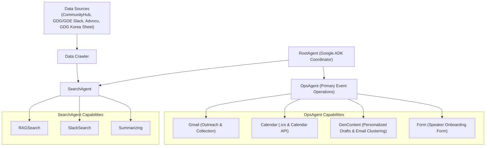

<p align="center">
  
</p>

<h1 align="center">Genmunity</h1>

<p align="center">
  <strong>Genmunity</strong> is an agentic community building & DevFest event operations platform built with <strong>Google ADK (<code>google-adk</code>)</strong>, <strong>Gemini 2.5 (<code>google-genai</code>)</strong>, <strong>Google Workspace APIs (Gmail, Forms, Calendar)</strong>, and <strong>FastAPI</strong>.
</p>

---

## Architecture



---

## Key Workflows

### 1. `SearchAgent` (CommunityHub & Speaker Matching)
Crawls community sources (`CommunityHub`, `GDG/GDE Slack`, `Advocu`, and [GDG Korea Domestic Organizers Sheet](https://docs.google.com/spreadsheets/d/1tC31_8IuWH-2TIeX0t84nyRI0YyaBSI52n97acG32-c/edit?usp=sharing)) to answer organizer queries:
- **"DevFest 핸즈온 행사에 필요한 스피커 연사를 찾고 있어"**
  - **1st Speaker (첫번째 연사자)**: **한성민** (`sniper45han@gmail.com`) — **AI GDE**
  - **2nd Speaker (두번째 연사자)**: **박제창** (`aristojeff@gmail.com`) — **Flutter GDE**
- **"올해 DevFest 행사는 언제까지?"**
- **"DevFest 지원가능한 예산은?"**

### 2. `OpsAgent` (End-to-End Post-Planning Speaker Automation)
1. **Speaker Search Handoff (`get_target_speakers_tool`)**: Loads the matched speakers (`한성민` AI GDE `sniper45han@gmail.com`, `박제창` Flutter GDE `aristojeff@gmail.com`).
2. **Personalized Outreach via Gmail (`generate_and_send_speaker_emails_tool`)**: Uses Gemini (`GenContent`) to craft tailored Korean invitation emails and sends them via the **Gmail API**.
3. **Gmail Receipt Verification & AI Clustering (`collect_and_cluster_event_emails_tool`)**: Collects event-related emails from **Gmail** and clusters them into operational groups using Gemini (`섭외 발송 및 수신 확인`, `연사 회신 및 세션 조율`, `발표자 온보딩 및 현장 운영`).
4. **Speaker Onboarding Form Generation (`create_speaker_onboarding_form_tool`)**: Generates a speaker information registration form collecting:
   - **발표자 성함** (Speaker Name)
   - **이메일** (Email)
   - **연락처** (Phone Number)
   - **티셔츠 사이즈** (T-Shirt Size: `S` ~ `3XL`)
   - **차량 번호** (Vehicle License Plate Number for venue parking)
   - **핸즈온 세션 제목** (Session Topic)
5. **Speaker Form & Calendar Invitation (`invite_speakers_with_form_and_calendar_tool`)**: Sends the onboarding Form link and an RFC-5545 `.ics` Calendar Invite (`METHOD:REQUEST`) via Gmail to both speakers.

---

## Quick Start

```bash
# 1. Create virtual environment & install dependencies
uv venv --python 3.12 .venv
source .venv/bin/activate
pip install -r requirements.txt

# 2. Run the FastAPI Builderthon Live Demo Dashboard
uvicorn app:app --host 0.0.0.0 --port 8080 --reload

# 3. Or launch with Google ADK Web UI
adk web
```

Open `http://localhost:8080` in your browser to access the interactive Builderthon Dashboard.
