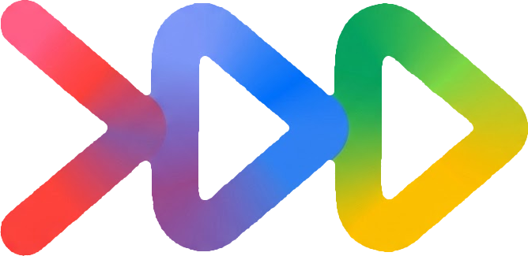

<p align="center">
  
</p>

<h1 align="center">Genmunity</h1>

<p align="center">
  <strong>Genmunity</strong> is an agentic community building and DevFest event operations platform built with <strong>Google ADK (<code>google-adk</code>)</strong>, <strong>Gemini 4.0 Argon</strong> (primary) and <strong>Gemini 3.8 Flash</strong> (secondary fallback), <strong>Google Workspace APIs (Gmail, Forms, Calendar)</strong>, and <strong>FastAPI</strong>.
</p>

---

## Architecture


---

## Model Configuration

Genmunity is configured to prioritize **Gemini 4.0 Argon** with automatic failover to **Gemini 3.8 Flash**:

- **Primary Model (`GENMUNITY_MODEL`)**: `gemini-4-argon`
- **Secondary Fallback Model (`GENMUNITY_SECONDARY_MODEL`)**: `gemini-3.8-flash`

Both the Google ADK multi-agent runner (`RootAgent`, `SearchAgent`, `OpsAgent`) and the `GenContent` service calls automatically retry with `gemini-3.8-flash` if the primary model is unavailable.

---

## Key Workflows

### 1. `SearchAgent` (CommunityHub & Speaker Matching)
Crawls community sources (`CommunityHub`, `GDG/GDE Slack`, `Advocu`, and the [GDG Korea Organizers & GDE Directory Sheet](https://docs.google.com/spreadsheets/d/1tC31_8IuWH-2TIeX0t84nyRI0YyaBSI52n97acG32-c/edit?usp=sharing)) to answer organizer queries:
- **Speaker Discovery for DevFest Hands-on Sessions**:
  - **1st Speaker**: **Sungmin Han** (`sniper45han@gmail.com`) — **AI GDE** (*Multi-Agent Community Automation Hands-on with Google ADK & Gemini 4.0 Argon*)
  - **2nd Speaker**: **Jechang Park** (`aristojeff@gmail.com`) — **Flutter GDE** (*Cross-Platform AI App Hands-on with Flutter & Gemini API*)
- **DevFest Season Schedule & Reporting Deadlines**: Official season runs through December 31, 2026 (final Advocu report and reimbursement due within 14 days post-event).
- **DevFest Chapter Budget Policy**: Tiered grant support from $1,500 to $5,000 depending on attendee scale and hands-on tracks, plus separate GDE travel support.

### 2. `OpsAgent` (End-to-End Post-Planning Speaker Automation)
Automates the entire speaker operations lifecycle after event planning:
1. **Speaker Search Handoff (`get_target_speakers_tool`)**: Loads the matched speakers (`Sungmin Han` AI GDE `sniper45han@gmail.com`, `Jechang Park` Flutter GDE `aristojeff@gmail.com`).
2. **Personalized Outreach via Gmail (`generate_and_send_speaker_emails_tool`)**: Uses Gemini (`GenContent`) to craft tailored invitation emails and dispatches them via the **Gmail API**.
3. **Gmail Receipt Verification & AI Clustering (`collect_and_cluster_event_emails_tool`)**: Collects event-related emails from **Gmail** and clusters them into operational groups using Gemini (Outreach & Delivery Verification, Speaker Replies & Session Coordination, Speaker Onboarding & Logistics).
4. **Speaker Onboarding Form Generation (`create_speaker_onboarding_form_tool`)**: Generates a speaker information registration form collecting:
   - **Speaker Name**
   - **Email**
   - **Phone Number**
   - **T-Shirt Size** (`S` to `3XL`)
   - **Vehicle License Plate Number** (for venue parking registration)
   - **Hands-on Session Topic & Requirements**
5. **Speaker Form & Calendar Invitation (`invite_speakers_with_form_and_calendar_tool`)**: Sends the onboarding Form link and an RFC-5545 `.ics` Calendar Invite (`METHOD:REQUEST`) via Gmail to both speakers.

### 3. Mail Administrator OAuth & Real-Time Inbound Email Trigger
Supports OAuth 2.0 registration for the designated Mail Administrator account (`devstar5011@gcplab.me`) and monitors `INBOX` via background polling and Cloud Pub/Sub push webhooks (`/gmail-webhook`). When a speaker reply arrives, `OpsAgent` automatically triggers email clustering, onboarding Form creation, and Calendar invite dispatch.

```bash
# Register Mail Administrator via OAuth 2.0
.venv/bin/python register_mail_admin.py --email devstar5011@gcplab.me

# Check current Mail Administrator & Watch status
.venv/bin/python register_mail_admin.py --status
```

---

## Quick Start

```bash
# 1. Create virtual environment & install dependencies
uv venv --python 3.12 .venv
source .venv/bin/activate
pip install -r requirements.txt

# 2. Run the FastAPI Live Demo Dashboard
uvicorn app:app --host 0.0.0.0 --port 8080 --reload

# 3. Or launch with Google ADK Web UI
adk web
```

Open `http://localhost:8080` in your browser to access the interactive Genmunity Dashboard.

---

## Testing & Deployment

```bash
# Run test suite
.venv/bin/pytest -q

# Deploy to Google Cloud Run
./deploy.sh
```
